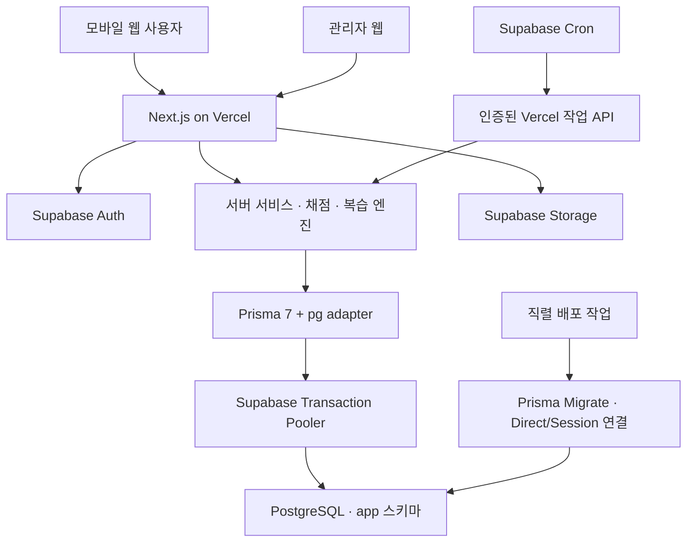

# 필수 회화 문장 암기 앱 — 개발 실행 계획 v1

작성: 2026-10-14. 상태: 계획 수립 완료, 구현 미착수.
제품 기준: [제품 기획안](mobile-conversation-memory-product-plan-2026-10-14.md).
이번 확정 사항: Next.js 최신 안정 버전, PostgreSQL, Prisma, Vercel, Supabase.
현재 저장소에는 제품 기획 문서만 있고 앱·패키지·DB·배포 설정은 없다. 아래 코드 경로와 명령은 생성할 산출물이며 기존 구현 사실이 아니다.

## 1. 목표와 완료 범위

관리자가 검수한 문장 세트를 발행하면 사용자가 선택하고, 정답 없이 회상하고, 결과에 따라 다음 복습을 배정받으며, 날짜별 이력과 유지 성과를 확인할 수 있는 모바일 웹 MVP를 만든다.

완료는 세 단계로 나눈다.

1. 로컬 구현 완료: 전체 핵심 흐름과 자동 검증 통과, 로컬 Supabase로 재현 가능.
2. 배포 검증 완료: Vercel + Supabase 스테이징에서 인증·DB·Storage·Cron·PWA 실환경 확인.
3. 운영 준비 완료: 운영 환경 분리, 콘텐츠 검수, SMTP, 백업·복구 확인, 모바일 실기기 점검 완료.

앱 개발 완료와 7일/30일 학습 효과 검증은 구분한다. 파일럿 관찰 기간은 구현 일정과 별도다. 이번 요청은 개발 계획 수립이며 프로젝트 생성·유료 가입·배포·계정 변경을 실행하지 않는다.

## 2. 기술 스택과 버전 정책

공식 문서 및 npm registry를 2026-10-14 KST에 조회한 스냅샷이다.

| 영역 | 개발 기준 | 용도 |
|---|---|---|
| 프레임워크 | Next.js 16.4.0 관측, 착수 시 최신 안정 패치 재확인 | App Router, Server Components, Route Handlers |
| UI 런타임 | React / React DOM 19.3.0 | Next.js 호환 UI |
| 언어/실행 | TypeScript strict, Node.js 24.x | 로컬·CI·Vercel 메이저 통일 |
| 패키지 관리 | pnpm, packageManager와 lockfile 고정 | 재현 가능한 설치 |
| 스타일 | Tailwind CSS, 작은 공통 컴포넌트 집합 | 모바일 사용자 화면·독립 관리자 화면 |
| DB | Supabase 관리형 PostgreSQL | 콘텐츠·학습 이력·작업 상태 |
| ORM | prisma / @prisma/client / @prisma/adapter-pg 7.10.0 + pg | 서버 DB 접근, Prisma Migrate |
| 인증 | Supabase Auth + @supabase/ssr + supabase-js | 쿠키 기반 SSR 인증 |
| 파일 | Supabase Storage | 검수 음원, 콘텐츠 자산 |
| 호스팅 | Vercel | 웹·Node.js 서버 API |
| 예약 실행 | Supabase Cron → Vercel 작업 API | 알림 대상 조회·제한된 배치 실행 |
| 입력 검증 | Zod | API·환경 변수·콘텐츠 가져오기 경계 검증 |
| 자동 검증 | Vitest, Playwright, ESLint, tsc | 도메인·DB 통합·브라우저 테스트 |

Next.js 16.4와 React 19.3 호환 방향은 공식 릴리스 [R1], Node 24 지원은 Vercel 문서 [R4]에서 확인했다. Supabase SSR 0.12.7, supabase-js 2.117.3도 조회했으나 이 부수 패키지는 착수 시 peer dependencies를 확인해 lockfile에 확정한다.

**Prisma 주의점:** 현재 `prisma@latest`는 8.0.0-rc.22이며 정식 안정판이 아니다. 공식 문서가 7 계열 유지 방법을 안내한다 [R3]. 따라서 CLI·Client·adapter를 모두 7.10.0으로 맞추고 프로젝트에 설치된 `pnpm exec prisma`만 실행한다. 이 계획 중간에 8 RC로 자동 전환하지 않는다.

Next.js는 10월 14일 보안 업데이트를 예고했다 [R2]. 실제 착수·배포 직전에 릴리스와 적용 대상 버전을 재조회하고 발표된 적용 대상 패치를 반영한다. 아직 공개되지 않은 영향 범위나 수정 버전은 추정하지 않는다. 조사 시점의 16.4.0을 영구 고정하는 계획이 아니다.

DB 메이저는 Supabase 프로젝트 생성 때 실제 제공 버전을 기록하고 로컬/CI를 맞춘다. PostgreSQL 최신 upstream 메이저가 Supabase에서도 즉시 제공된다고 가정하지 않는다. 추가 상태 관리 프레임워크, Redis, 별도 API 서버, AI SDK는 MVP에 도입하지 않는다.

## 3. 애플리케이션 경계



- 사용자·관리자 웹은 같은 Next.js 프로젝트에 두되 각각 AppShell/AdminShell과 라우트 경계를 갖는다.
- 페이지 초기 조회는 Server Components → 서버 서비스로 직접 호출한다. 내부 HTTP 우회 호출을 만들지 않는다.
- 학습 제출·일정 변경·콘텐츠 변경은 `/api/v1` Route Handlers로 통일한다. 서비스가 권한·트랜잭션·도메인 규칙을 소유한다.
- 클라이언트는 진행 UI와 임시 입력만 담당한다. 정답·검증 등급·다음 복습 시각의 최종 결정은 서버가 한다.
- 사용자별 결과·토큰 갱신 응답은 공유 캐시에서 제외한다. 캐시를 쓰는 공개 세트 메타데이터는 발행 버전으로 식별하고 수정 시 무효화한다. Next.js 16.4의 Cache Components 기본값을 확인하며 인증 데이터가 캐시 경계에 섞이지 않게 한다.
- Prisma 호출이 있는 경로는 Node.js runtime으로 통일한다. 런타임 시작 때 클라이언트를 재사용하고 매 요청 연결/종료를 하지 않는다.
- DB 변경과 푸시 발송은 같은 트랜잭션으로 묶을 수 없으므로 DB 작업 상태를 먼저 남기고 외부 발송은 재시도 가능한 별도 처리로 수행한다.

## 4. DB 연결·스키마·마이그레이션

### 연결

- `DATABASE_URL`: Vercel 런타임용 Supabase transaction pooler, 통상 6543. 실제 호스트는 Dashboard Connect 값 사용.
- `DIRECT_URL`: 마이그레이션용 direct connection. 실행 환경의 IPv6 접근이 안 되면 session pooler 5432로 검증 후 사용. transaction pooler로 마이그레이션하지 않는다.
- `prisma.config.ts`가 CLI용 DIRECT_URL을 읽고, 서버의 PrismaPg adapter는 DATABASE_URL을 읽도록 분리한다 [R5, R6].
- adapter의 pg pool 크기·획득/연결 timeout을 명시한다. 초기 후보 max=3, connectionTimeoutMillis=5000을 실제 계획 용량과 부하 측정으로 조정한다. Prisma 6용 connection_limit 설정을 Prisma 7에 그대로 복사하지 않는다.
- transaction pooling의 prepared statement 및 세션 상태 제약을 채택 adapter 버전으로 실제 검증한다. pg adapter에 효과 없는 URL 플래그를 해결책으로 가정하지 않는다.
- TLS 인증서 검증을 유지하고 실패하면 CA/연결 설정을 수정한다.

### 접근 및 소유권

앱 테이블은 Data API에 노출하지 않는 `app` 스키마에 둔다. 일반 사용자 브라우저는 Prisma·SQL 연결 문자열에 접근하지 않는다. 불필요한 Supabase Data API는 비활성화하거나 노출 스키마에서 app을 제외한다.

런타임 DB 역할은 app 테이블에 필요한 DML만 부여하고 스키마 소유/DDL/CREATEDB/BYPASSRLS 권한을 주지 않는다. 마이그레이션 역할과 분리한다. 이 설계의 사용자 간 격리는 서버의 소유권 검사로 수행한다. Supabase Auth의 JWT가 Prisma 연결에 자동 전파되어 `auth.uid()` 정책을 적용해 준다고 가정하지 않는다. 공개 스키마와 Storage의 RLS·권한은 별도로 점검한다.

Prisma는 app 스키마만 관리한다. Supabase의 auth/storage 내부 테이블을 모델링하거나 재생성하지 않는다. Prisma migration SQL은 app 테이블·인덱스·권한 변경의 이력 원본이다. extension·Cron·Storage bucket·Auth 설정은 별도 멱등 설정 스크립트와 운영 문서로 관리하며 동일 app 테이블을 Supabase migration과 이중 관리하지 않는다.

### 배포

개발: 로컬/일회성 DB에서 `pnpm exec prisma migrate dev`로 SQL 생성·검토. CI·스테이징·운영: `pnpm exec prisma migrate deploy`로 적용. `db push`와 `migrate reset`은 운영 배포 경로에 포함하지 않는다.

빌드 명령은 client generate와 next build만 수행한다. Vercel 모든 Preview 빌드에서 운영 migration을 실행하는 방식은 사용하지 않는다. DDL 자격증명은 배포 작업에만 제공하고 일반 런타임에는 주지 않는다. generate 과정이 설정을 읽을 때 운영 DDL 비밀이 필요하지 않도록 빌드 모드 환경 검증을 분리한다.

스키마 변경은 추가→호환 코드 전환→후속 정리 순으로 한다. 앱 롤백이 DB를 롤백하지 않는다는 전제로 SQL 복구·백업 확인을 별도 운영 절차로 만든다.

## 5. 인증·관리자·음원

MVP 로그인: 이메일/비밀번호, 이메일 확인, 로그아웃, 비밀번호 재설정. Google/Kakao 등의 소셜 로그인은 후속 범위다. 게스트는 3문장 체험만 가능하고 영구 학습 기록은 로그인 후 서버에 저장한다.

- `@supabase/ssr`의 서버/브라우저 클라이언트와 `src/proxy.ts`로 세션 쿠키 갱신 [R7].
- 페이지·API에서 검증된 사용자 ID를 얻고 `AppUser`의 현재 상태와 역할을 확인한다. 사용자 메타데이터의 role이나 요청 body의 userId를 신뢰하지 않는다.
- 관리자 요청은 최신 Auth 사용자 조회와 DB의 현재 ADMIN 역할·활성 상태를 확인한다. proxy는 탐색/갱신 보조이며 서버 인가를 대체하지 않는다.
- `getClaims`의 서명 검증과 Auth 세션의 즉시 폐기는 같은 보장이 아니다. 앱의 정지/권한 회수는 DB 상태로 후속 요청에 반영하고 Supabase 세션 종료의 토큰 유효기간 정책은 문서화한다.
- 최초 관리자는 검증된 Auth ID를 지정한 운영 CLI로 생성한다. 최초 가입자가 자동 관리자 되는 기능은 만들지 않는다.
- Auth ID와 AppUser는 UUID로 연결하고 검증된 로그인에서 멱등 upsert한다. Auth 내부 스키마를 Prisma가 관리하지 않는다. 탈퇴는 앱 비활성화→관련 데이터/자산 처리→Auth 삭제의 재시도 가능한 절차로 정의한다.

음원은 private bucket을 기본으로 한다. 관리자 인가 후 짧은 수명의 업로드 권한을 발급하고 업로드 완료 시 MIME·크기·대본/문장 연결을 확인한다. 학습 요청에는 접근 가능한 발행 콘텐츠의 재생 URL만 발급한다. 정답을 드러내는 음원은 평가 중 정답 공개 전 요청 경로에서도 제한한다. Storage 관리자용 secret key는 서버 전용이며 일반 DB 조회에는 사용하지 않는다.

공개 파일럿의 이메일 확인·재설정에는 실제 SMTP 발송 설정이 필요하다. Supabase 기본 SMTP를 범용 운영 발송으로 가정하지 않는다 [R9]. 로컬은 Supabase 로컬 메일 도구로 검증하며 외부 SMTP 계정 선택은 배포 준비 항목이다.

## 6. 학습 데이터와 원자성

| 모델 그룹 | 주요 모델 | 핵심 제약 |
|---|---|---|
| 사용자 | AppUser, StudyPlan, ScheduleException | auth ID 고유, IANA timezone, 요일/N일 규칙 구분 |
| 콘텐츠 | Sentence, SentenceVersion, PromptVariant, AudioAsset | 발행 버전 불변, 음원과 버전 연결 |
| 세트 | StudySet, SetRevision, SetSentence | 세트 버전·문장 순서, 문장 원본 재사용 |
| 선택 | Enrollment, UserSentencePreference | 사용자×세트 고유, 사용자×문장 설정 고유 |
| 학습 | StudySession, SessionItem, ReviewEvent, ExposureEvent | 서버 발급 문항, 첫 답안, 힌트·노출 이력, 멱등 키 |
| 상태 | UserSentenceState | 사용자×문장×능력 유형 고유, 정책 버전·다음 복습·동시성 버전 |
| 평가 | AssessmentAssignment, AssessmentResult | 평가 대상 사전 고정, 응시 창·미응시 구분 |
| 운영 | ContentIssue, AuditLog | 신고 및 관리자 변경 이력 |
| 알림 | PushSubscription, NotificationDelivery, JobRun | 사용자/슬롯/종류 중복 방지, lease·재시도·최종 결과 |

초기 학습 능력은 입력 회상과 말하기 자기확인을 구분한다. 세트 간 동일 문장의 상태는 공유하며 뜻/패턴의 학습 목표가 바뀌는 개정은 새 항목 또는 명시적 재검증 정책으로 처리한다.

학습 제출 처리는 서버 트랜잭션 안에서 사용자/문항 소유권 확인→콘텐츠·노출 이력 조회→첫 시도 채점→ReviewEvent 저장→UserSentenceState 갱신으로 진행한다. `(userId, eventId)`와 문항의 첫 제출 제약을 두고 optimistic version 또는 행 잠금으로 여러 탭의 충돌을 처리한다. 같은 키에 다른 payload를 재전송하면 충돌을 반환하고 기존 결과를 바꾸지 않는다.

정답은 최초 문제 payload·RSC HTML·prefetch·서비스워커 캐시에 포함하지 않는다. 힌트/정답 공개 요청은 ExposureEvent로 남기고, 이후 제출을 무힌트 성공으로 승급시키지 않는다. 정답 비교로 인해 발생하는 이번 노출은 이번 시험 이전 노출 시각과 분리해 지연 기준을 평가한다.

네트워크 단절 중 제출은 eventId와 함께 기기 내 임시 보관하고 재접속 시 전송한다. 서버 승인 전에는 ‘동기화 대기’로 표시한다. 재전송은 정상 응시와 구분된 client/server 시간·지연 여부를 남기며 과거 학습일로 임의 소급하지 않는다. 과도한 지연이나 문항 만료는 미확정 연습으로 처리하고 재시험한다. 완전 오프라인 채점은 MVP 범위 밖이다.

## 7. 구현할 화면·API·파일

화면: `/` 소개·체험, `/login`, `/onboarding`, `/today`, `/sets`, `/sets/[id]`, `/study/[sessionId]`, `/sentences`, `/history`, `/settings`; 관리자는 `/admin`, `/admin/sets`, `/admin/sentences`, `/admin/imports`, `/admin/issues`.

대표 API 계약:

| API | 책임 |
|---|---|
| GET /api/v1/sets | 발행 세트 검색·페이지네이션 |
| POST/DELETE /api/v1/enrollments | 세트 선택·해제, 공유 문장 이력 보존 |
| PUT /api/v1/study-plan | 일정·시간 예산·타임존 변경 |
| POST /api/v1/study-sessions | 세션·문항 서버 발급 |
| POST /api/v1/study-sessions/[id]/answers | 입력/자기확인 제출, 멱등 처리 |
| POST /api/v1/study-sessions/[id]/reveals | 힌트/정답 공개와 노출 기록 |
| GET /api/v1/history | 날짜·상태별 실제 이력 |
| POST /api/v1/admin/sets/[id]/publish | 발행 검증·버전 확정 |
| POST /api/v1/admin/imports | 가져오기 미리 보기/검증/확정 |
| POST /api/v1/push-subscriptions | 알림 기기 구독 저장 |
| POST /api/jobs/dispatch | Cron 인증·작업 선점·제한 배치 |

입력 검증, 현재 사용자·관리자 검사, 소유권 검사, 허용 Origin 검증, 요청 한도·중복 처리의 책임을 공통 서버 경계에 둔다. 공개 URL 입력을 서버에서 임의 다운로드하는 음원 가져오기는 제외한다.

```text
src/
  app/(public)/           소개·체험·인증
  app/(learner)/          사용자 AppShell과 학습 화면
  app/admin/             AdminShell·콘텐츠 운영
  app/api/v1/            공개 앱 API
  app/api/jobs/          내부 작업 API
  app/manifest.ts        PWA manifest
  components/            필요한 공통 UI
  features/              study, sets, history, admin
  domain/                grading, review, scheduling, assessment
  server/                db, auth, repositories, services, storage, jobs
  lib/supabase/          SSR/브라우저 클라이언트
  generated/prisma/      Prisma 7 생성 위치
  proxy.ts
prisma/schema.prisma
prisma/migrations/
prisma/seed.ts
prisma.config.ts
supabase/config.toml     로컬 Supabase 설정
scripts/platform/       역할·bucket·Cron 등 멱등 설정
tests/unit/
tests/integration/
tests/e2e/
docs/architecture.md
docs/deployment.md
docs/content-spec.md
docs/pilot-protocol.md
DESIGN.md
.env.example
```

## 8. 날짜·요일·주기·알림 실행

복습 엔진은 DB나 현재 시각을 직접 참조하지 않는 순수 함수로 만든다. 현재 시각·노출 이력·능력·정책 버전을 입력받고 상태 변화와 dueAt을 출력한다. 실제 학습 가능 시간으로의 배정은 별도 일정 함수가 담당한다.

정책 v1은 제품 기획의 1→3→7→14→30일 상대 간격, 힌트/실패 재학습, 최근 노출 간격 기반 검증을 구현한다. 같은 날 정답 반복·말하기 자기평가·직전 음원 청취를 지연 입력 회상으로 합산하지 않는다.

요일 또는 N일 반복에 날짜별 예외를 적용하고 dueAt·scheduledAt·performedAt을 따로 남긴다. 오늘 큐는 요청 시 계산할 수 있게 하므로 Cron이 멈춰도 학습은 계속된다. 복습 부채가 시간 예산을 채우면 신규 문장을 감량한다.

알림 기본 경로는 **Supabase Cron의 5분 주기 HTTP 호출 → Vercel `/api/jobs/dispatch`**다. Supabase Cron은 HTTP 호출을 지원한다 [R8]. Vercel Hobby Cron은 하루 1회 제한이 있어 사용자의 여러 학습 시간대를 처리하는 기본 경로로 삼지 않는다 [R10]. 외부 호출에 의한 Vercel Function 사용량은 별도 발생한다.

- URL·트리거 비밀은 Supabase Vault 등 서버 비밀 저장소에 저장하고 저장소에는 값 없는 템플릿만 둔다.
- 작업 API는 bearer secret, 배포 환경, 활성화 플래그를 검사한다. Vercel 배포 보호가 켜진 스테이징은 허용된 우회 방식으로 실제 연결을 확인한다.
- 한 tick에서 제한된 사용자/알림만 선점하고 cursor·lease·재시도 횟수를 DB에 남긴다. 외부 푸시를 호출하는 동안 DB 트랜잭션을 열어 두지 않는다.
- 동시 호출·재호출은 고유 delivery key로 억제한다. 발송 성공 직후 기록 전 장애에는 중복 가능성이 남으므로 exactly-once 전달을 보장하지 않고 알림 tag/짧은 TTL로 완화한다.
- 5분 주기는 서버 조회 간격이며 기기 수신 정시 보장은 아니다. 조용한 시간·만료 시각을 지난 알림은 취소한다.
- Preview 환경은 실제 사용자 푸시를 기본 비활성화한다. 스테이징 테스트 구독만 허용한다.
- 무효한 구독은 정리하고 실패 로그·마지막 정상 실행 시각을 기록한다. 프로세스 내부 setInterval에 영구 일정을 맡기지 않는다.

## 9. 단계별 작업과 통과 기준

| 단계 | 주요 작업·산출물 | 선행 | 통과 기준 |
|---|---|---|---|
| M0 기반 | 최신 안정 패치 재확인, Next scaffold, pnpm/TS/ESLint, DESIGN.md, 반응형 shell, CI 명령 | 없음 | 설치·lint·typecheck·build 통과, 360px 기본 화면 |
| M1 데이터·인증 | Prisma 모델/마이그레이션, 로컬 Supabase, Auth SSR, DB 역할/관리자 guard, seed | M0 | 새 DB 재생성, 2사용자 격리, 역할 회수 검증 |
| M2 콘텐츠 | 문장/세트/버전 CRUD, CSV 검증, private 음원 업로드, 검수·발행, 관리자 preview | M1 | 샘플 2세트 발행, 초안 차단, 실패한 가져오기 부분 반영 방지 |
| M3 첫 학습 | 세트 선택, onboarding, session 발급, 입력 회상·말하기 자기확인, 정답 공개, 최초 채점 | M2 | 관리자 발행→사용자 선택→학습→기록 E2E; 정답 조기 노출 없음 |
| M4 복습·일정 | 순수 복습 엔진, 날짜/요일/N일 규칙, 오늘 큐, 부채 감량, 잠시 중지/복귀 | M3 | 고정 시계·DST·중복·실패·동시 탭 테스트 통과 |
| M5 테스트·기록 | 주간 누적·응용 문항, 7/30일 평가 배정, 달력·상태·개인 메모·신고·관리자 품질 지표 | M4 | 자기평가/검증 구분, 평가 분모·미응시·과거 이력 대조 |
| M6 PWA·알림 | manifest/service worker, 설치 안내, 구독, Cron dispatch, 제출 재전송 | M4 | 권한 거절·미지원 대안, 중복 tick/실패 재시도, 캐시 개인정보 점검 |
| M7 스테이징 | 별도 Supabase, Vercel preview/staging, env/SMTP/Storage/Cron 연결, DB 부하 점검 | M5, M6 | 배포 실환경 E2E·음원·메일·푸시 검증, 운영 환경 미접속 |
| M8 출시 준비 | 운영 migration 절차, 복원 연습, 초기 콘텐츠 검수, 실기기 QA, 운영 문서·파일럿 계측 | M7 | 출시 체크리스트와 검증 증거, 남은 외부 조건 명시 |

첫 번째 시연 목표는 M3이다. 이를 완료하면 사용자가 화면과 실제 학습 흐름을 평가할 수 있다. M4가 제품의 핵심 암기 기능을 완성하고, M5~M8에서 평가·운영 품질을 확보한다.

독립 작업은 도메인/DB 계약 확정 후 사용자 UI·관리자 UI·테스트로 나눌 수 있다. 스키마·마이그레이션·인증 경계는 단일 소유자가 통합한다. 각 단계는 수정 파일·통과 테스트·검증 공백을 보고하며 날짜만으로 완료 판정하지 않는다. 기간 추정은 M0/M1 실측과 콘텐츠 제작 가능량으로 갱신한다.

## 10. 환경과 배포 경로

| 환경 | 앱 | 데이터 | 외부 작업 |
|---|---|---|---|
| Local/CI | Next 로컬·CI 프로세스 | 로컬 Supabase 또는 테스트용 Postgres | 로컬 메일·푸시 mock |
| Preview | Vercel preview | 비운영 전용 프로젝트/브랜치 | 실사용 메일·푸시 차단 |
| Staging | 안정된 Vercel 스테이징 주소 | 스테이징 Supabase | 테스트 수신자만 |
| Production | Vercel 운영 주소 | 독립 Supabase 운영 프로젝트 | 검증한 운영 연동 |

초기는 운영/비운영 Supabase 프로젝트를 분리한다. Preview가 공용 비운영 DB를 사용하면 스키마를 변경하는 분기의 검증을 직렬화한다. 여러 버전의 동시 테스트가 필요할 때만 별도 브랜치/프로젝트를 할당하며, 모든 요금제에서 무제한 브랜치를 쓸 수 있다고 가정하지 않는다.

앱과 DB는 제공되는 리전 중 가능한 가까운 위치로 배치한다. 한국 사용자를 우선하되 실제 계정의 선택 가능 리전·요금제를 확인해 결정한다. 운영 데이터 복사 대신 seed 데이터로 Preview를 구성한다.

필수 설정 목록:

| 설정 | 노출 범위 |
|---|---|
| NEXT_PUBLIC_SUPABASE_URL / NEXT_PUBLIC_SUPABASE_PUBLISHABLE_KEY | 공개 클라이언트 설정 |
| DATABASE_URL | 런타임 서버 전용, 제한된 DB 역할 |
| DIRECT_URL | 로컬 migration·보호된 배포 작업 전용 |
| SUPABASE_SECRET_KEY | 필요한 Storage/Auth 관리 동작의 서버 전용 |
| APP_ORIGIN / JOB_TRIGGER_SECRET | 환경별 origin 및 Cron 인증 |
| NEXT_PUBLIC_VAPID_PUBLIC_KEY / VAPID_PRIVATE_KEY / VAPID_SUBJECT | 공개키만 클라이언트; private key 서버 전용 |
| SMTP·Auth redirect allowlist·Storage bucket·Cron URL | Supabase/Vercel 환경별 설정 |

저장소 CI는 GitHub Actions를 기본 제안으로 하되 실제 원격 저장소 연결 때 확정한다. 비밀이 없는 검증 작업과 운영 비밀을 사용하는 배포 작업을 분리하며 신뢰하지 않는 PR에는 운영 비밀을 전달하지 않는다.

배포 순서: frozen lockfile 설치→generate→정적 검사/테스트→build→스테이징 migration→스테이징 배포/실측→운영 호환 migration→운영 앱 배포→smoke check. 스테이징 검증 전후 코드와 migration 버전을 기록한다. 실패 시 신규 쓰기 기능을 중지하고 호환 앱으로 되돌리되 DB 복구는 별도 절차로 판단한다.

운영 비용은 Vercel 실행량·Supabase DB/Storage/egress·SMTP·음원 제작으로 나눠 계측한다. 무료 요금제가 상용 운영·예약 작업·백업 요구를 모두 충족한다고 가정하지 않는다. 유료 전환은 실제 사용량과 계정 조건에 따라 별도 결정한다.

## 11. 검증과 인수 기준

제안 실행 명령: `pnpm lint`, `pnpm typecheck`, `pnpm test:unit`, `pnpm test:integration`, `pnpm test:e2e`, `pnpm build`, `pnpm verify:full`. 초기 scaffold에서 실제 scripts로 만든다.

1. 새 로컬 환경에서 문서만으로 install→Supabase 시작→migration→seed→앱 시작 가능.
2. CLI/Client/adapter 버전이 일치하고, 운영 runtime 역할로 DDL이 거절됨. pooled 연결과 migration 연결을 각각 검증.
3. 사용자 A는 사용자 B의 계획·세션·문장 상태를 조회/변경할 수 없음. 관리자 권한 회수 후 후속 API 요청 거절.
4. 초안·보관 문장은 정책에 따라 차단되고 콘텐츠 의미 변경은 과거 판정을 덮어쓰지 않음.
5. 정답이 첫 문항 HTML/JSON/RSC/prefetch/cache에 포함되지 않음. 힌트/음원 공개 후 제출은 무도움 회상으로 승급하지 않음.
6. 동일 제출 10회 재전송 시 ReviewEvent와 상태 전이가 한 번 발생. 두 탭 동시 제출도 한 개의 첫 시도만 확정.
7. 1/3/7/14/30일 간격과 실제 노출 조건, 실패 후 재학습을 fake clock으로 검증. 긴 관찰 성과를 시뮬레이션 결과만으로 주장하지 않음.
8. 날짜 예외·월수금·2일 주기·DST·시간대 변경·7일 부재 후 복귀를 고정 사례로 검증.
9. 두 세트에 공유된 문장을 합계에서 중복 집계하지 않음. 세트 하나를 해제해도 다른 세트의 문장 복습 유지.
10. 주간 테스트와 예정 복습이 겹쳐도 상태 중복 갱신 없음. 추적 평가에서 미응시·기간 밖 응시를 분리.
11. 푸시 거절·마이크 없음·음원 오류·연결 단절에서 대체 동작. 임시 답안은 로그아웃 시 정리하고 서버 확인 전 완료로 표시하지 않음.
12. 동일 Cron tick 동시 실행·함수 timeout·푸시 410/429/5xx 처리 및 lease 재획득 검증. 오래된 알림은 발송하지 않음.
13. 운영 계정·키·데이터가 Preview에 없음. migration이 일반 Vercel build에서 실행되지 않음.
14. iOS Safari/홈 화면 PWA와 Android Chrome 실기기에서 로그인·입력 키보드·음원·푸시 확인. 자동 WebKit 테스트를 iOS 실기기 검증으로 대체하지 않음.
15. 출시 전 검수된 약 10세트/150문장과 음원·권리 기록 확보. 자동 생성 초안은 검수 완료 콘텐츠로 간주하지 않음.
16. 비운영 백업 복원 연습으로 DB 이력과 음원 객체의 복구 범위를 각각 확인. 선택 요금제의 백업/PITR 제공 범위를 운영 문서에 기록.

성능 목표 가설: 합의한 테스트 데이터 1만 문장·10만 ReviewEvent, 동시 사용자 20명에서 오늘 큐/제출 API warm p95 1초 이내. cold start는 별도 측정한다. 실제 운영 SLO는 파일럿과 계정 용량에 따라 조정한다. 360px부터 핵심 화면 가로 넘침 없이 동작하며 접근성 이름·초점·키보드 조작을 확인한다.

운영 로그에는 requestId·실행 시간·실패 종류·job ID를 남기되 답안 원문·토큰·DB URL·음성 원본을 출력하지 않는다. DB pool timeout, 제출 실패, Cron 누락, 푸시 실패를 각각 관찰한다.

## 12. 주요 결정과 남은 외부 조건

| 결정/위험 | 실행 기준 |
|---|---|
| Next.js 최신 안정 버전 요구 | 착수·출시 전 registry/보안 공지 재검증, exact dependency와 lockfile 갱신 |
| Prisma 8 RC 혼입 | 7.10.0 명시 고정, 설치된 CLI만 호출 |
| serverless DB 연결 증가 | transaction pooler + 작은 명시 pool + 통합 부하 테스트 |
| Prisma와 Supabase RLS 혼동 | 앱 데이터는 서버 중계·소유권 검사, Storage 권한 별도 검증 |
| 자동 migration의 운영 오염 | 비운영 환경 분리, 보호된 직렬 deploy 작업 |
| 알림의 정시성/중복 | 학습 큐는 Cron 독립, lease/고유키/만료, 전달 보장 범위 명시 |
| 객관 검증과 자기평가 혼합 | 능력/판정 출처 분리, 첫 시도와 노출 로그 보존 |
| 콘텐츠 생산이 병목 | M2부터 샘플 2세트 검수, 배포 준비와 병행 |

실환경 연결 시 필요한 외부 조건은 Vercel·Supabase 프로젝트 접근, 배포 저장소, 도메인/redirect 설정, 실제 SMTP 발송 수단, 콘텐츠·음원 검수다. 이 정보가 없어도 로컬 scaffold·DB 모델·도메인·화면·테스트·배포 템플릿은 진행할 수 있다. 실제 접근이 없을 때는 배포 완료로 표시하지 않는다.

이번 계획의 다음 구현 시작점은 M0→M1이며, 첫 사용자 시연은 M3 완료 시점이다. 후속 구현 요청이 오면 이 순서와 인수 기준을 작업 기준으로 사용한다.

## 13. 공식 근거

- [R1 Next.js 16.4 릴리스](https://nextjs.org/blog/next-16-4), [npm next latest](https://registry.npmjs.org/next/latest)
- [R2 Next.js 2026-10-14 보안 업데이트 사전 공지](https://nextjs.org/blog/upcoming-nextjs-security-update-october-2026)
- [R3 Prisma release status: v8 RC, v7 유지](https://www.prisma.io/docs/orm/release-status), [npm Prisma 7.10.0](https://registry.npmjs.org/prisma/7.10.0)
- [R4 Vercel Node.js 지원 버전](https://vercel.com/docs/functions/runtimes/node-js/node-js-versions)
- [R5 Supabase Prisma 연결](https://supabase.com/docs/guides/database/prisma), [Postgres 연결 모드](https://supabase.com/docs/guides/database/connecting-to-postgres)
- [R6 Prisma 7 구성 및 adapter 변경](https://www.prisma.io/docs/guides/upgrade-prisma-orm/v7), [DB 연결](https://www.prisma.io/docs/orm/prisma-client/setup-and-configuration/databases-connections)
- [R7 Supabase SSR 클라이언트/인증/캐시](https://supabase.com/docs/guides/auth/server-side/creating-a-client?queryGroups=framework&framework=nextjs)
- [R8 Supabase Cron](https://supabase.com/docs/guides/cron), [Cron 설정](https://supabase.com/docs/guides/cron/quickstart)
- [R9 Supabase SMTP](https://supabase.com/docs/guides/auth/auth-smtp), [Storage 접근](https://supabase.com/docs/guides/storage/security/access-control)
- [R10 Vercel Cron 주기 제한](https://vercel.com/docs/cron-jobs/usage-and-pricing)
- [R11 Next.js PWA 가이드](https://nextjs.org/docs/app/guides/progressive-web-apps)

검증 기록: 공식 문서와 npm 메타데이터 조회, 기존 요구사항과 계획의 대응 점검. 앱·DB 연결·실제 배포 테스트는 구현 후 각 milestone에서 수행한다.

독립 계획 검토: critic이 제품 MVP 대응, 구현 의존성, 인증·연결·배포·알림 경계를 검토했으며 실행을 막는 중대한 누락은 발견하지 않았다. 이는 문서 검토 결과이며 코드 실행이나 배포 검증 결과가 아니다.
